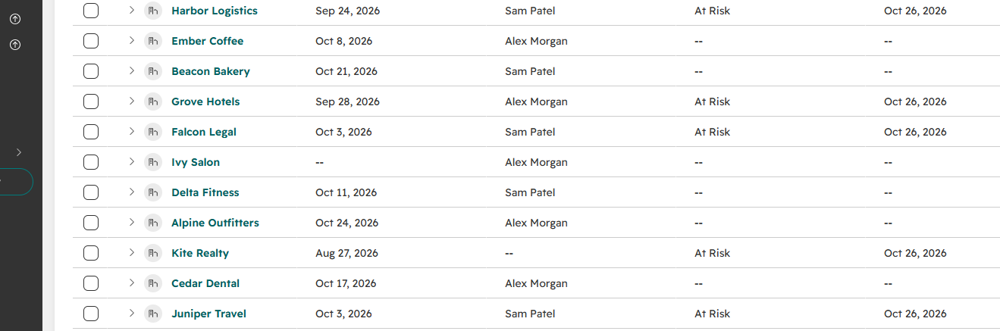
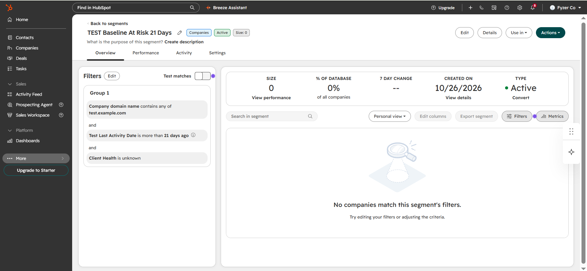
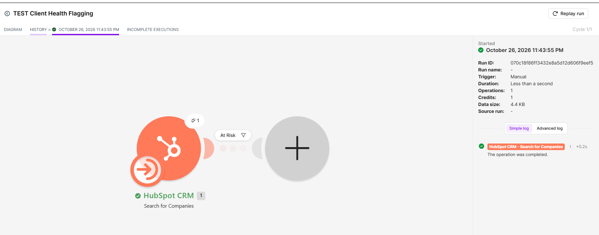
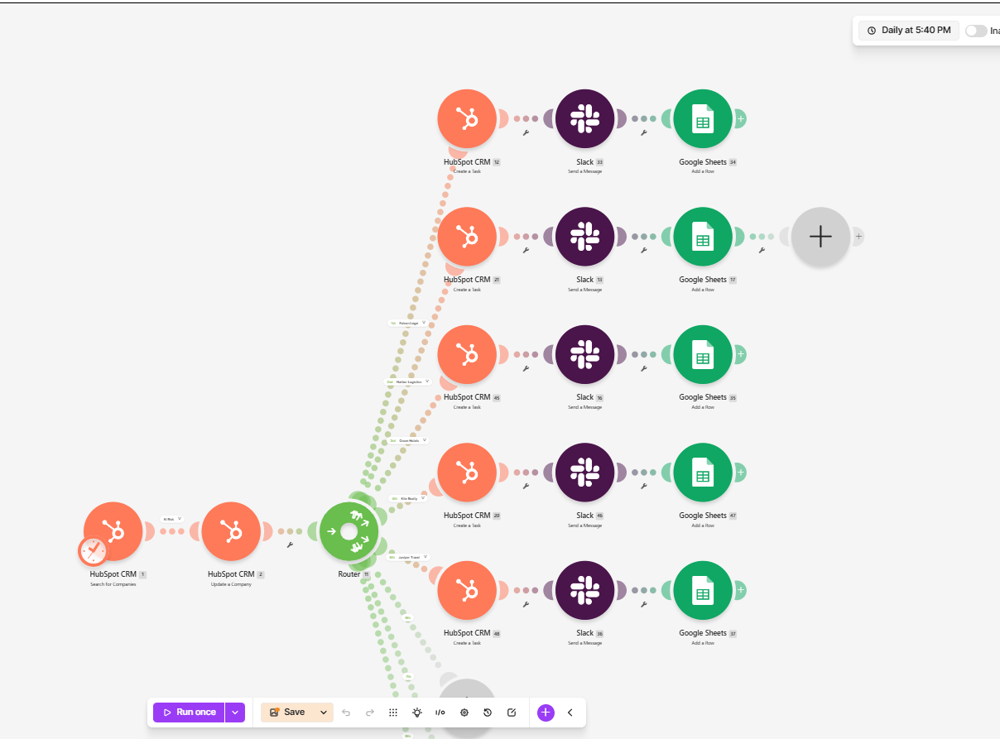
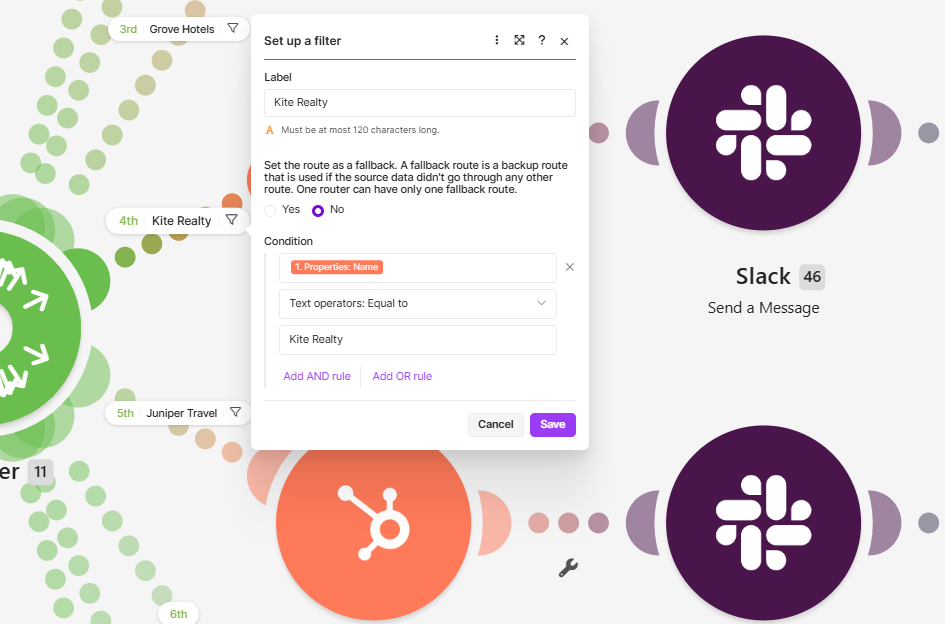
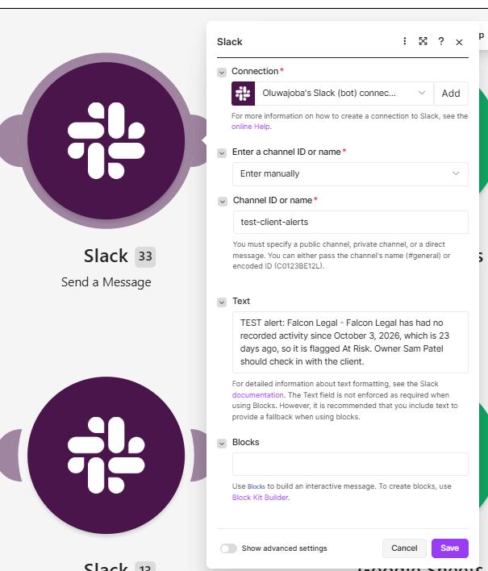
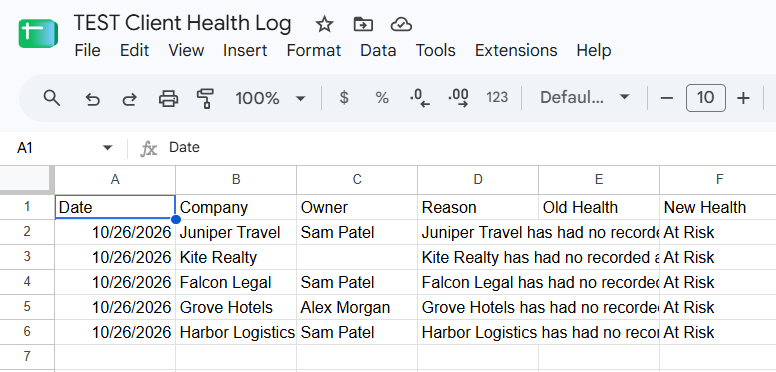
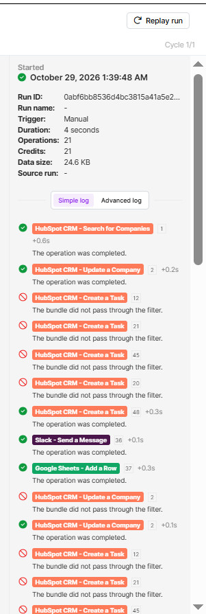

  

# Crestline — Client Health Flagging System

**Account managers cannot see when a client is slipping, so they find out when the client leaves.**

**Clement Okeniyi** · RevOps & Support Operations

---

## About this repo

**Crestline is a fictional B2B services company created for this demonstration.** This is a test system built on fictional data in free-tier tools. It is not a live client system, no real client used it, and no result here is a production business result.

The system checks 11 HubSpot test companies, applies a rule to decide who is slipping, and — for flagged accounts only — updates the company record, creates a HubSpot task for the owner, sends a Slack alert, and logs a row in Google Sheets. A rule decides who is flagged. AI only writes the explanation, and a human edits it.

📋 [Results — verified clean run](docs/results.md) · 🔧 [What broke](docs/what-broke.md) · 📄 [Handover](docs/handover.md) · 🧠 [AI explanation prompt](docs/ai-explanation-prompt.md) · 📐 [Design blueprint](docs/design-blueprint.md)

---

## The problem

Account managers had no early signal. A client could go quiet for three weeks and nobody was prompted to act — no task, no alert, no log row. The baseline proved it: 5 test companies had no recorded activity for more than 21 days, and none of them had an alert task. That was the gap, and the cause: no early signal existed.

---

## What I built

| Layer | Tool | Purpose |
|---|---|---|
| CRM of record | HubSpot (free) | 12 test companies, 3 custom properties, baseline list |
| Automation | Make (free) | Scenario TEST Client Health Flagging — manual trigger, 5 routes |
| Alerts | Slack | Private channel test-client-alerts |
| Audit log | Google Sheets | TEST Client Health Log — Clients, Alert Log, Run Log tabs |
| Explanation | Claude (manual step) | One plain-language sentence per flagged account |

---

## The rule

Measured from October 26, 2026, on Test Last Activity Date only.

| Health | Condition |
|---|---|
| At Risk | More than 21 days since last activity, and Client Health blank |
| Watch | 14–20 days since last activity |
| Healthy | Under 14 days since last activity |
| Needs Data | Activity date blank — never At Risk |

Baseline result: **5 At Risk, 2 Watch, 3 Healthy, 1 Needs Data, out of 11 companies counted.** The 12th record is a deliberate duplicate (see below).

---

## Test data — deliberately messy

12 company records in [`data/test-data-12-companies.csv`](data/test-data-12-companies.csv), imported into HubSpot with the mess left in on purpose:

- **Duplicate pair:** Harbor Logistics and Harbour Logistics — same domain, same contact, same deal value. HubSpot deduped them to one survivor, so the total counted is **11, not 12**.
- **Missing owner:** Kite Realty has no Test Owner. It is still flagged, shown as unassigned — it must not disappear.
- **Blank activity date:** Ivy Salon has no Test Last Activity Date. A blank date is never At Risk; it goes to Needs Data.
- **Odd date format:** Juniper Travel's date was written as 03-Oct-2026, not ISO format. Corrected to 2026-10-03 before import.

---

## 01 — HubSpot companies in place

Three custom properties on the Company object, created before import: Test Last Activity Date (date), Client Health (dropdown: Healthy, Watch, At Risk, Needs Data — left blank on import, owned by the automation after that), and Last Alert Sent (date, left blank on import). Test Owner is a single-line text field, because the standard owner field could not be matched on import.

---

## 02 — Baseline list, before any automation ran

The baseline list TEST Baseline At Risk 21 Days, size 5: Falcon Legal, Grove Hotels, Harbor Logistics, Juniper Travel, Kite Realty. Client Health blank on all 5, no alert task on any of them. This list is the proof the problem was real before anything was built.

---

## 03 — Filter test

The filter test passed exactly the same 5 companies out of 11 in. Blocked 6: Alpine, Beacon, Cedar, Delta, Ember, Ivy. Ivy was blocked because a blank date is not earlier than the cutoff.

---

## 04 — Router design, one route per company

The Make scenario searches HubSpot companies, applies the At Risk filter, then routes each company to its own route: Falcon, Harbor, Grove, Kite, Juniper. Each route has its own Task, Slack and Sheet modules with a static sentence for that company — no variable formula, after the Tools-variable approach output raw formula text instead of an evaluated sentence. Routes 6–9 are empty stubs that do not run.

---

## 05 — The break: Kite, the silent failure

Kite Realty's last activity was August 27, 2026 — 60 days ago. It should have been At Risk, but nothing happened for Kite: no task, no alert, no row, and no error was shown. The cause: the Kite filter variable was plain text "Company Name", not the Company Name pill, so it never equalled "Kite Realty" and Kite passed 0 bundles. The fix, saved: the filter variable is the [1. Properties: Name] pill, operator Equal to, value Kite Realty. The full break log — 15 breaks, including the import failures, the crossed run and the two-save trap — is in [docs/what-broke.md](docs/what-broke.md).

---

## 06 — A flagged account, working end to end

Falcon Legal — last activity October 3, 2026, 23 days ago, owner Sam Patel. Task, Slack alert and Sheet row all carry the same sentence: company, last activity date, days since activity, and owner.

---

## 07 — Alert Log: 0 → 5 rows

After the clean run the Sheet Alert Log went from 0 data rows (headers only, confirmed before the run) to 5 rows, one per company, each with the correct sentence and New Health At Risk. Kite Realty's Owner column is blank, as designed — Kite has no Test Owner and its sentence states the owner is unassigned.

---

## 08 — Clean run verified

**Clean run, evening of October 28, 2026 — Run ID `0abf6bb8536d4bc3815a41a5e2073e83`, manual trigger, 4 seconds, 21 operations.**

| Step | Count | Verified |
|---|---|---|
| Companies checked | 11 | Search, 1 operation |
| Companies updated to At Risk | 5 | Falcon, Harbor, Grove, Kite, Juniper |
| HubSpot tasks created | 5 | Task 12 Falcon, 21 Harbor, 45 Grove, 20 Kite, 48 Juniper |
| Slack alerts sent | 5 | In test-client-alerts only |
| Sheet rows logged | 5 | One per company, no duplicates |

After the run the filter was restored to Client Health Does not exist, a completion heartbeat was sent to test-client-alerts, and a Run Log row was added (October 26, 2026 — 11 checked, 5 flagged, Success). The "did not pass through the filter" lines in the run log are normal route filtering: each company is blocked on the 4 routes that are not its own, and completes on its own route only. The scenario was left **Inactive**, with no schedule enabled and no second run.

---

## The AI control

> "I use Claude to draft the explanation, I edit it, and the rule decides who is flagged. That is the control."

The Claude step is **manual, not an API call** — the free test scope has no paid API key, and no Claude API output is faked in this build. Version 1 of the prompt had no length limit, no exact fields, no rule for a blank owner, and no ban on guessing. Version 2, my edit, allows exactly one plain-language sentence under 30 words, using only Company Name, Test Owner and Test Last Activity Date — and forbids inventing a reason for the silence. Both versions, the reasons generated for the 5 flagged accounts, and why each change was made are in [docs/ai-explanation-prompt.md](docs/ai-explanation-prompt.md).

---

## What this is not

- **No adoption.** No real account manager used this live. A one-week pilot with one owner is proposed in the handover, not claimed.
- **No time saved, no revenue claimed.** No calculation method was established for either, so neither is estimated here.
- **No threshold-to-notification time.** The 4-second run duration is the automation's own runtime, not a business response time.
- **The crossed run is kept, not hidden.** An earlier run (Run ID `3b989fe9125042b795b4f46b4dd6eaf4`, 32 operations) logged 9 Sheet rows with Juniper duplicated 5 times, because route membership did not follow visual drag position on the canvas. Old HubSpot tasks and Slack alerts from that run remain; clean-run counts use a timestamp cutoff for those two outputs.
- **Known limits:** the filter uses a fixed date (Test Last Activity Date earlier than October 5, 2026) — a live version needs a rolling date calculation. HubSpot tasks carry the company in the title and notes but are not associated to the company record, because Make offers no Company ID target for task association. The Claude step is manual. Routes 6–9 are empty stubs.

---

## Handover — how to run it, and how to pause it

Manual trigger only. The scenario is Inactive and the schedule is not enabled — that is the safe parked state. To pause a live version, set the scenario to Inactive in Make; do not delete the scenario, the HubSpot test companies, or the Sheet. On an alert: read the Slack alert and the HubSpot task, check in with the client that day, then update Client Health with the outcome. If the data is wrong, fix the HubSpot test fields, not the rule. Full handover, including the reviewer questions, is in [docs/handover.md](docs/handover.md).

---

## 📁 Documentation

| Document | Description |
|----------|-------------|
| [Results](docs/results.md) | Baseline vs flagged, every run with IDs, and the verified clean run |
| [What broke](docs/what-broke.md) | 15 breaks in the order found, with causes and fixes |
| [Handover](docs/handover.md) | What it does, who gets alerts, how to pause it, known limits |
| [AI explanation prompt](docs/ai-explanation-prompt.md) | Prompt Version 1 and Version 2, and the 5 generated reasons |
| [Design blueprint](docs/design-blueprint.md) | Original design document — only the flagging slice was built |

---

## Stack

`HubSpot CRM (Free)` &nbsp; `Make (Free)` &nbsp; `Slack` &nbsp; `Google Sheets` &nbsp; `Claude (manual step)` &nbsp; `CSV`

---

Built by **C Okeniyi** · RevOps Specialist

*Test system, fictional data. Rules decide who is flagged; AI only writes the explanation.*

